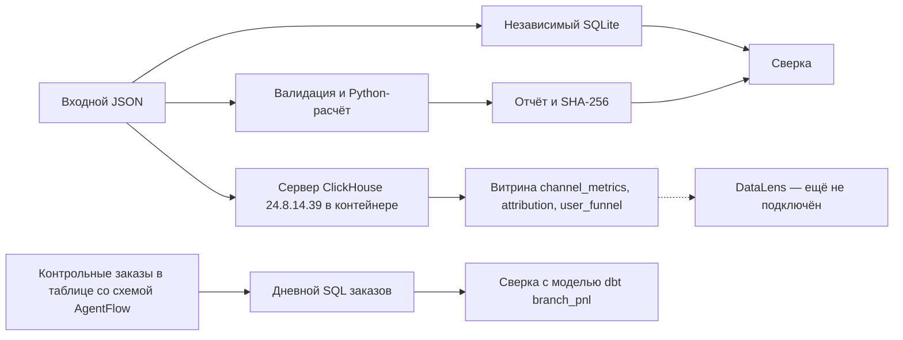

# Рекламная воронка и атрибуция по каналам — конспект

## 1. Зачем

Обещание: DataLens осваиваю в тестовом проекте — синтетические продажи и расходы по каналам, воронка «показ → клик → установка → регистрация → подписка», сравнение моделей last click, linear и time decay с окном post-view в ClickHouse, CPA и маржа с проверкой агрегатов по SQL; open-source DataLens в Docker с подключением к ClickHouse из AgentFlow и дашбордом с селекторами по филиалу и периоду.

Итог одной фразой (из [BRIEF](BRIEF.md)): на 488 синтетических событиях 120 пользователей (seed) я собираю последовательную воронку 120 → 99 → 75 → 58 → 37, сравниваю три модели атрибуции подписок, считаю CPA и маржу по каналам в копейках и сверяю результаты Python, SQLite и сервера ClickHouse.

Локальный учебный расчёт сравнивает три модели атрибуции синтетических подписок и сохраняет суммы в копейках. Его проверяют три пересчёта: SQL в SQLite заново считает веса каналов и воронку; скрипт `scripts/audit.py` по этим весам проверяет копейки каждой подписки и канальные итоги с CPA и маржой; SQL на сервере ClickHouse сам строит из исходных событий и расходов распределение, CPA и маржу. Это подготовка к работе с инструментом на учебных данных; коммерческий опыт не заявляется. DataLens ещё не запускался, а заказы AgentFlow проверены на контрольных данных с его подлинной схемой, не на живом кластере.

## 2. Задача простыми словами

Есть события пользователей: показ рекламы, клик, установка, регистрация, подписка — и расходы на каждый рекламный канал. Нужно ответить на два вопроса. Сколько пользователей дошли до каждого шага воронки по порядку? Какому каналу засчитать каждую подписку с её выручкой и себестоимостью, чтобы посчитать CPA и маржу канала? Ответ зависит от модели атрибуции, поэтому считаются три модели и сравниваются между собой. Деньги хранятся в целых копейках, и при делении подписки между каналами ни одна копейка не должна потеряться.

## 3. Как устроено



Python формирует эталонный отчёт, SQLite проверяет его независимым SQL. Версия для ClickHouse читает те же события и расходы на сервере ClickHouse (в контейнере на iMac) и рассчитывает готовые таблицы для подключения DataLens. Для карточки заказов AgentFlow написан дневной SQL; он сверен с месячной моделью dbt `branch_pnl` на контрольных заказах в таблице, созданной по подлинному DDL AgentFlow.

## 4. По шагам

1. **Вход.** Генератор с фиксированным seed создаёт события и расходы (или берётся сохранённый JSON). Валидатор проверяет типы, уникальность идентификаторов, время с поясом и целые неотрицательные копейки.
2. **Окно касаний.** Для каждой подписки берутся касания того же пользователя строго до неё: клики за 7 суток. Если кликов нет — показы за последние 24 часа. Если нет и показов — подписка уходит в `unattributed`.
3. **Три модели.** Last click отдаёт всю подписку последнему касанию (при равном времени — касанию с большим `event_id`). Linear делит её поровну между касаниями. Time decay даёт касанию вес `2^(−возраст в сутках)` и нормирует веса до суммы 1.
4. **Копейки.** Выручка и себестоимость подписки делятся методом наибольших остатков: каждый канал получает целую часть своей квоты, оставшиеся копейки — каналы с наибольшим остатком, при равенстве — первый по имени. В linear и last click квота и остаток считаются в целых числах (`divmod`), в time decay — в числах с плавающей точкой.
5. **Отчёт и проверка.** Канальные итоги: подписки, выручка, себестоимость, расходы, CPA = расходы / подписки (без подписок — пусто), маржа. Отчёт сохраняется вместе со входом и SHA-256. Скрипт `scripts/audit.py` проверяет хеши и пересчитывает всё по SQL в SQLite, не импортируя пакет расчёта. Определения — в [METRICS](METRICS.md).

Изменение генератора или версии Python может изменить будущую синтетику, поэтому сохранённый вход — основной эталон.

## 5. Результаты

| Прогон | Реальные цифры |
|---|---|
| [Синтетический снимок](runs/2026-10-31-synthetic/report.json), seed 20261031 | 488 событий; 120 пользователей; 44 подписки. Последовательная воронка: 120 → 99 → 75 → 58 → 37. В last_click: display 9, search 14, social 14, unattributed 7; email — 0. |
| [18.11.2026](runs/2026-11-18-clickhouse.md), сервер ClickHouse 24.8.14.39 | Те же воронка и подписки last click; 174 строки распределения по 44 подпискам, 15 строк канальной витрины. В каждой модели выручка 19 018 500 коп., себестоимость 8 558 325 коп., расходы 211 517 коп., маржа 10 248 658 коп. Email: расходы 10 000 коп., маржа −10 000 коп., CPA `NULL`. Полный CI на iMac — 15 модульных и 4 интеграционных теста. |
| [19.11.2026](runs/2026-11-19-second-audit.md), правки после аудита | Пример «пять кликов канала a, один клик b, подписка на 9 копеек»: до правки linear давал a 7 и b 2 копейки, после — 8 и 1 в Python, аудите и SQL ClickHouse. Красные прогоны до правки — в протоколе. Полный CI на iMac после правок (`20261119-161024`, коммит `ff67e38`) — 44 модульных и 6 интеграционных тестов. Отчёт эталонного снимка не изменился. |
| [18.11.2026](runs/2026-11-18-agentflow.md), контрольные заказы со схемой AgentFlow | Филиал `msk` за 31 января — 1 февраля — 3 заказа; суммы по филиалу и месяцу совпали с моделью dbt за январь и февраль. Полный CI на iMac — 15 модульных и 5 интеграционных тестов. |

Цифры синтетического снимка впервые получены в прогоне 31.10 на Windows ([протокол](runs/2026-10-31-local.md)). Этот прогон доказательством не служит; доказательство — пересчёт на сервере ClickHouse в CI на iMac (вторая строка).

37 — число пользователей, прошедших все шаги воронки; 44 — все события подписки, в том числе без полного пути. Нельзя подменять один знаменатель другим. Модели распределяют уже случившиеся конверсии и не оценивают причинный эффект рекламы.

## 6. Как запустить

Из корня репозитория, bash (в PowerShell вместо префикса `PYTHONPATH=src` один раз задать `$env:PYTHONPATH = 'src'`):

```bash
PYTHONPATH=src python -m marketing_funnel --out reports/demo --size 120 --seed 20261031
python scripts/audit.py reports/demo
```

Для расчёта нужен только Python 3.11+ со стандартной библиотекой. Тесты и Ruff идут в CI по `.github/workflows/ci.yml` (`pip install '.[dev]'`, `ruff check`, `ruff format --check`, `pytest -q`); интеграционные тесты `tests/clickhouse_cases.py` дополнительно запускают сервер ClickHouse в контейнере. В последнем полном прогоне на iMac задача `unit` заняла 22 с (из них pytest — 1 с), задача `clickhouse` — 20 с (pytest с сервером — 17 с) ([протокол](runs/2026-11-19-second-audit.md#полный-прогон-после-правок)). [Команды загрузки](../README.md#витрина-в-clickhouse) · [Протокол стенда](runs/2026-11-18-clickhouse.md)

Для проверки в DataLens подготовлен стенд: `bash stand/run.sh` на Linux-машине с Docker или в GitHub Codespaces. Скрипт поднимает DataLens v2.9.0 и ClickHouse и загружает снимок. Затем он через API создаёт подключение, датасеты, карточки и дашборд, читает числа из DataLens и сравнивает их с эталоном. Стенд ещё ни разу не запускался: я писала его по документации и исходному коду DataLens. [Протокол подготовки](runs/2026-11-19-stand-prep.md) · [README: стенд](../README.md#стенд-datalens)

## 7. Вопросы на собеседовании

**Почему атрибуция и воронка дают разные числа?** Атрибуция включает все подписки, воронка — только пользователей со всеми предшествующими шагами.

**Когда учитывается показ?** Только при отсутствии клика за 7 суток и при показе за последние 24 часа.

**Почему linear даёт дробные подписки?** Одну конверсию делят несколько допустимых касаний; сумма долей сохраняется.

**Что означает time decay?** Более давнее касание получает меньший вес; за каждые сутки ненормированный вес уменьшается вдвое.

**Как не потерять копейку?** Распределять целые суммы методом наибольших остатков, проверяя сохранение на каждой подписке. Остатки нужно сравнивать точно: в linear я считаю квоту и остаток в целых числах через `divmod`. Независимый аудит нашёл, что с весами в float пример «пять кликов канала a, один клик b, подписка на 9 копеек» давал a 7 и b 2 копейки вместо 8 и 1; сумма сходилась, а каналы — нет. В time decay остатки по-прежнему считаются в float, это записано в ограничениях README.

**Чем CPA отличается от маржи?** CPA связывает расходы и число конверсий, маржа дополнительно учитывает выручку и себестоимость.

**Можно ли по этому отчёту увеличивать бюджет канала?** Нет: синтетические данные и описательная атрибуция не доказывают инкрементальный эффект.

**Как проверяли SQL для AgentFlow без доступа к нему?** Таблицу создали по подлинному DDL AgentFlow, внесли контрольные заказы двух филиалов по обе стороны полуночи и одну строку без заголовка, затем сравнили дневной запрос с исходной моделью dbt `branch_pnl` по месяцам. Живой кластер AgentFlow при этом не использовался.

**От чего зависит граница дня заказа?** `toDate(order_date)` по `DateTime64(3)` без явного пояса считает день в часовом поясе сервера ClickHouse. В тесте пояс сервера не задавался. В прогоне 18.11 он не записывался; с 19.11 тест печатает `SELECT timezone()`, и тестовый контейнер ответил `UTC`. Результат теста от пояса не зависит: время вставлено строками и разбирается в том же поясе, в котором считается день. На сервере AgentFlow пояс нужно проверить, иначе заказы около полуночи уйдут в соседний день.

## 8. Как говорить честно

«DataLens осваиваю в тестовом проекте. Я загрузила учебный снимок на сервер ClickHouse, сравнила три модели атрибуции и сверила с эталоном распределение выручки и себестоимости до копейки. На канале email расходы остались видны даже при отсутствии подписок. Для заказов AgentFlow я написала дневной SQL и сверила его с месячной моделью dbt на контрольных данных с подлинной схемой. Сам DataLens я ещё не подключала: витрина и карточки в интерфейсе — следующий шаг. Коммерческого опыта с DataLens у меня нет.» [Протокол](runs/2026-11-18-clickhouse.md)

Чего проект не доказывает:

- работу в DataLens: подключение витрины `channel_metrics`, датасеты и карточки при выборе модели атрибуции и канала — DataLens не запускался;
- работу подготовленного стенда DataLens: запросы к API и конфигурации карточек написаны по исходному коду и не проверены прогоном;
- подключение к живому ClickHouse AgentFlow: дневной SQL проверен на контрольных данных с подлинной схемой, кластер AgentFlow был недоступен; селекторы «Филиал» и «Период» в интерфейсе не проверены;
- верную границу дня на сервере AgentFlow: часовой пояс — допущение, тест его не проверяет;
- дневные CPA и маржу: расходы в снимке заданы по каналам за весь период;
- точное распределение копеек в time decay при равных остатках: там квоты в float, и лишняя копейка может уйти не первому по имени каналу (пример — в ограничениях README);
- причинный эффект рекламы: атрибуция описательная, данные синтетические.

## 9. Глоссарий

Касание — показ или клик; post-view — конверсия после показа; атрибуция — распределение конверсий; last click — последнее касание с приоритетом клика; linear — равные веса; time decay — затухание веса со временем; CPA — расходы на атрибутированную конверсию; маржа — остаток после выбранных затрат.

- **DataLens** — BI-система Яндекса с открытой версией для Docker: подключения к базам, датасеты, чарты и дашборды с селекторами.
- **Датасет** — описание источника в DataLens: таблица или SQL-запрос и поля с типами.
- **Селектор** — фильтр дашборда (например, «Филиал» или «Период»), который меняет значения связанных карточек.
- **AgentFlow** — отдельный проект хранилища данных заказов на ClickHouse с моделями dbt; отсюда взяты DDL таблицы заказов и модель `branch_pnl` (коммит `250623a`).
- **dbt** — инструмент, который собирает витрины из SQL-моделей; здесь — модель `branch_pnl` с заказами по филиалам и месяцам.
- **`DateTime64(3)`** — тип ClickHouse для времени с миллисекундами; без явного пояса толкуется в поясе сервера.
- **Метод наибольших остатков** — способ разделить целые копейки по долям так, чтобы сумма не изменилась.
